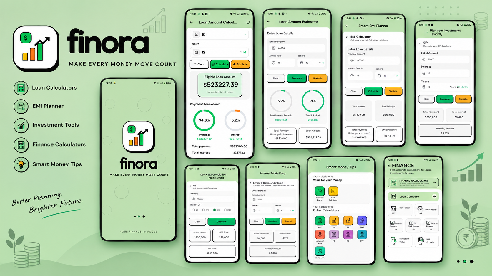

# Finora

Finora is a Flutter financial calculator app for quickly estimating loan payments, investment growth, tax, interest, and cash totals. It uses a mint-and-emerald neo-brutalist visual style with bold outlines, offset shadows, colorful calculator tiles, and animated percentage gauges.



## Features

- **Animated splash screen** with the Finora finance mark, animated chart bars, brand and tagline transitions, and a loading indicator. It opens the dashboard automatically.
- **Home dashboard** with popular calculator shortcuts, a finance toolkit card, and a money tip.
- **Finance hub** grouping calculators into Finance Calculator, Value for your Money, and Other Calculators categories.
- **EMI calculator** for monthly payments, principal and interest totals, payment breakdown gauges, and a month-by-month amortization schedule.
- **Loan amount estimator** that estimates eligible principal from a monthly EMI, annual rate, and tenure.
- **SIP calculator** for monthly investment, invested amount, projected interest, and maturity value.
- **GST calculator** with Add GST and Remove GST modes, preset rates (5%, 12%, 18%, 28%), and a custom amount.
- **Simple and compound interest calculator** with an interest mode switch, tenure units, invested amount, interest, and maturity summary.
- **Loan comparison** showing estimated monthly EMI for two interest rates on the same principal and tenure.
- **Cash calculator** with increment/decrement controls for common note denominations and a running total.
- **Statistics sheet** with principal, interest, payment, and remaining balance by month for EMI and loan estimates.
- **Responsive neo-brutalist components** including outlined cards, buttons, input fields, header pills, and animated circular gauges.
- **Android launcher icon** in density-specific PNG sizes, adaptive icon resources, and an Android 13 monochrome variant.

## Calculator behavior

Calculations are provided by `FinanceCalculatorService` and its result models:

- EMI uses the standard fixed-payment loan formula and builds a monthly amortization schedule.
- Loan amount estimation calculates the present value of the requested monthly EMI over the selected tenure.
- SIP estimates monthly contributions with monthly compounding and builds a month-by-month growth schedule.
- GST can be added to a base price or extracted from a tax-inclusive price.
- Interest summaries support simple and compound interest. Tenure can be entered in years or months.
- Zero annual interest rates are supported for EMI, loan amount, SIP, and interest calculations.

Currency figures are currently displayed with a dollar sign. The calculator UI is consolidated into reusable views; SWP, FD, Lumpsum, and PPF hub tiles currently open the related SIP or interest calculator, and VAT opens the GST calculator.

## Design and architecture

- **Flutter** provides the cross-platform UI.
- **GetX** provides named navigation and module bindings.
- **Google Fonts** supplies the Outfit typeface; **intl** formats financial values; **fl_chart** is available for charting.
- The percentage rings are drawn with a custom painter to match the design.
- A shared theme and color palette live in `lib/app/theme/`.
- Reusable neo-brutalist widgets live in `lib/app/widgets/`.
- Calculator data models and formulas are separated into `lib/app/data/`.
- Dashboard, hub, calculator, and splash views live in `lib/app/views/`.
- Route names and page registration live in `lib/app/routes/`.

### Routes

| Screen | Route |
| --- | --- |
| Animated splash | `/splash` |
| Home dashboard | `/home` |
| Finance hub | `/finance-hub` |
| EMI calculator | `/emi-calculator` |
| Loan amount estimator | `/loan-amount-calculator` |
| SIP calculator | `/sip-calculator` |
| GST calculator | `/gst-calculator` |
| Interest calculator | `/interest-calculator` |
| Loan comparison | `/compare-loans` |
| Cash calculator | `/cash-calculator` |

## Design assets

The supplied UI mockups and brand images are stored in `assets/`. The numbered screenshots present in the project are `1.png`–`10.png`, `12.png`–`14.png`, plus `1_5.png` (the alternate EMI calculator mockup).

| Asset | Description |
| --- | --- |
| `assets/finora_banner.png` | Brand and UI overview banner (shown above) |
| `assets/1.png` – `assets/10.png` | Calculator and finance hub mockups |
| `assets/1_5.png` | Alternate EMI calculator mockup |
| `assets/12.png` – `assets/14.png` | Additional app and splash mockups |

The numbered mockup images are design references; the Flutter app does not need to load them at runtime.

## Getting started

### Requirements

- Flutter SDK compatible with the Dart SDK constraint in `pubspec.yaml` (`^3.13.5`).
- Android Studio or another supported Flutter development environment for Android builds.

### Run locally

```sh
flutter pub get
flutter run
```

### Build Android debug APK

```sh
flutter build apk --debug
```

The APK is written to `build/app/outputs/flutter-apk/app-debug.apk`.

## Project layout

```text
lib/
  main.dart
  app/
    data/
      models/
      services/
    routes/
    theme/
    views/
    widgets/
    modules/                 # GetX controllers and bindings
assets/                      # Banner and numbered UI mockups
android/app/src/main/res/    # Android launcher icon resources
tool/                         # Launcher icon generation helper
```

## Android launcher icon

Launcher artwork is installed under `android/app/src/main/res/` as density-specific icons and adaptive icon resources. To regenerate the PNG density variants on Windows, run:

```powershell
./tool/generate_launcher_icons.ps1
```

## Verification

```sh
flutter analyze
flutter build apk --debug
```
